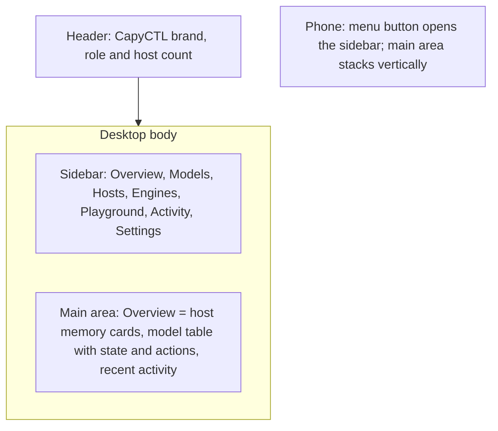
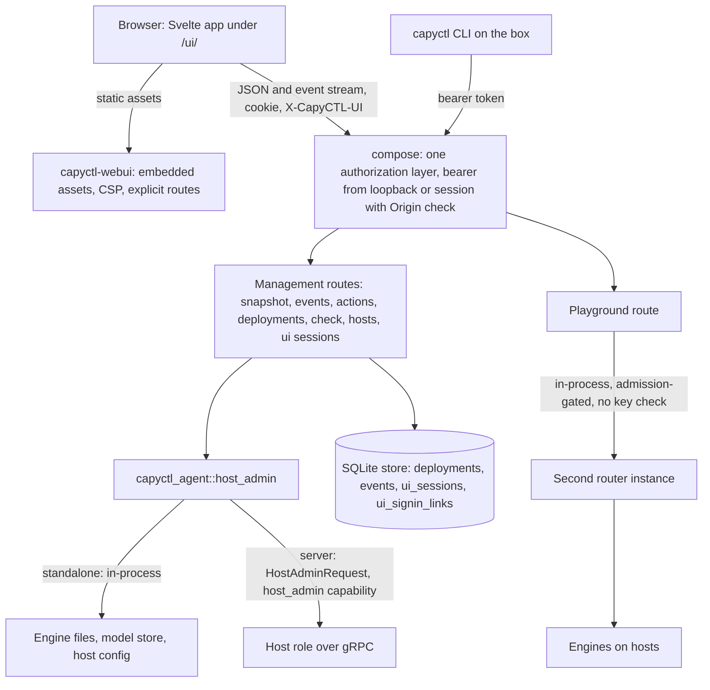
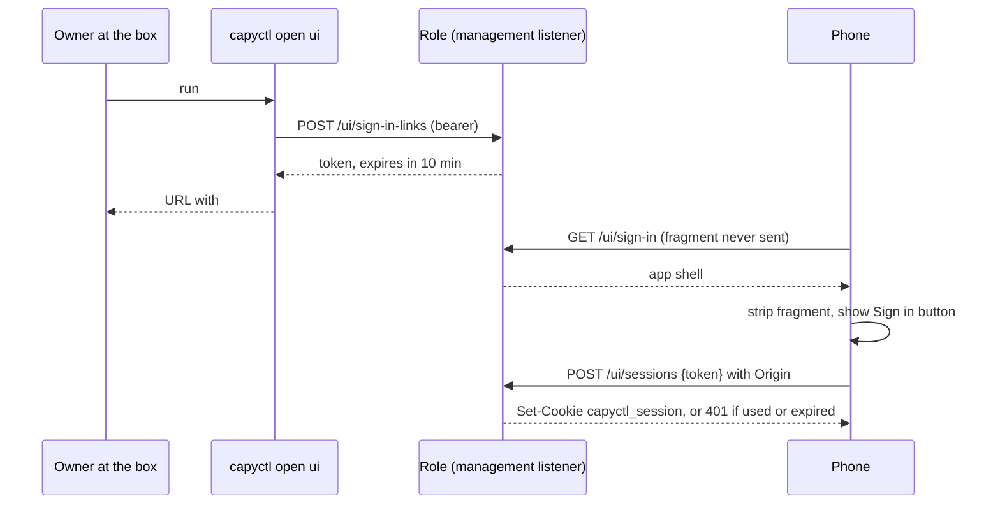
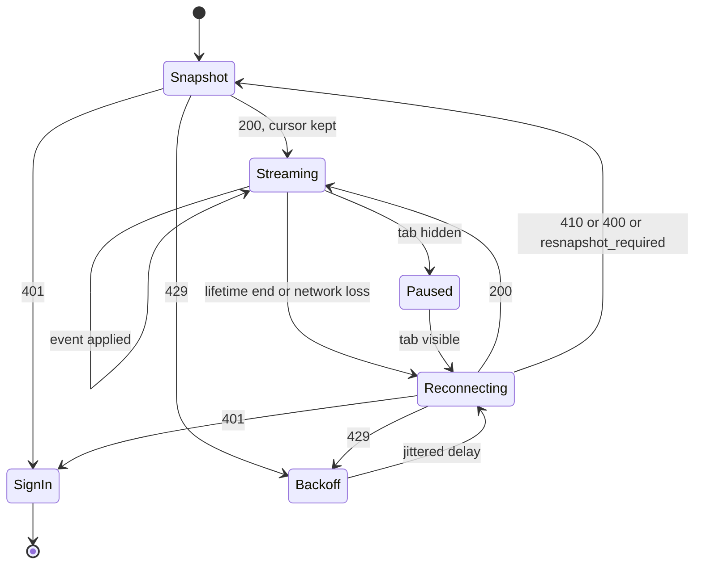

# CapyCTL Web UI - Plan

## Goal Capsule

- **Objective:** An owner-operator running CapyCTL on GPU machines they own can, after the first start, watch and run their whole setup from a browser on a desktop or phone: models, hosts, engines, memory, and trying models. Beyond first start, joining hosts and the role's own settings, the terminal is needed only to sign in a new device.
- **Means:** a web UI built into the server and standalone roles, acting only through the management API (Key Decision "The UI is built into the role and goes through the API"; KTD1, KTD14, KTD17).
- **Product authority:** `docs/SPEC.md` (the management API is the single semantic boundary for the CLI, a future UI and integrations: SPEC §14 and `docs/design/milestones/f2-sglang-design.md` §7), then this Product Contract for UI behavior, then the Planning Contract for mechanism. ADR 0040 (U1) amends ADR 0019 §10 and ADR 0031 §8.
- **Open blockers:** none. The off-box access and browser custom-engine parts must not ship without ADR 0040 in the same change.
- **Stop conditions:** stop and report if a settled Key Decision proves infeasible in code, if the all-routes authorization test cannot pass, or if the release archive cannot stay byte-identical with the UI embedded.
- **Execution profile:** phased. Units U1–U10 are the API and access foundations, U11–U18 the web app, and U19 the docs. A unit's tests land with the unit.
- **Who finishes:** the implementing agent delivers a pull request with every gate except Live passed. The owner merges, and runs the Live gate on the lab hosts before a release ships the UI.

---

## Product Contract

### Summary

A CapyCTL-branded web UI, built into the server and standalone roles, covers everything a running role can do: live observability, lifecycle actions, guided model setup, engine and host administration, and a playground for chat and decision models. It is single-user. You sign in through a one-time link issued by the CLI. It listens on loopback by default, and the owner can opt in to serving it on another address, such as a Tailscale address.

### Problem Frame

CapyCTL's audience is home users and prosumers running models on GPU machines they own. Today every interaction goes through the CLI on the box, and remote administration is `ssh` plus the local CLI (ADR 0019 §10). Answering "what is loaded, what is parked, how much GPU memory is free" means running `status` commands repeatedly and holding a picture of each host's memory in your head. Adding a model means hand-writing deployment YAML and finding out at deploy time whether it fits. Checking that a model works means writing a `curl` request.

The owner of one or a few GPU boxes is technical enough to install CapyCTL but wants to stop living in the terminal. They often want to check on or change their setup from a laptop or phone elsewhere on their network, including over Tailscale.

The groundwork is already in place. The F2 design defined a versioned snapshot, a resumable event stream, supported-action hints and structured refusal reasons as the contract "for a future UI" (`docs/design/milestones/f2-sglang-design.md` §7). What is missing is the UI itself, plus API coverage for operations that today exist only in the local CLI.

### Key Decisions

- **One product contract for the whole UI: watch, operate, set up and try.** (session-settled: user-directed — chosen over shipping Watch and Operate first as their own contract: the owner wants a full web UI, not a dashboard.) Governs R1–R36.
- **The primary user is the owner-operator.** (session-settled: user-directed — chosen over a non-technical household member, a two-tier owner-plus-others setup, and a newcomer doing first-run setup in the browser: the person who installed CapyCTL is the one using it.) Governs R15, R34–R36.
- **Single user, with the same authority as the CLI.** One owner and full control; no accounts or roles. Governs R5.
- **Loopback by default, with an owner opt-in to another address.** (session-settled: user-directed — chosen over loopback-only with SSH tunnels, network-reachable by default, and HTTPS-only off-box: reachable over Tailscale without exposing it by default.) Opting in makes the management API reachable off the box through the UI, which amends ADR 0019 §10. Governs R2, R3.
- **Off-box access is plain HTTP and prints no warning.** (session-settled: user-directed — chosen over built-in TLS and a private-address-only restriction: the owner's network, such as Tailscale, provides the protection, as with the inference listener in ADR 0019 §8.) Accepted risk: on a plain LAN, session cookies travel unencrypted. Governs R3.
- **Sign in through a one-time link or QR code issued by the CLI on the box.** (session-settled: user-directed — chosen over pasting the admin token and offering both: easy on a phone, revocable, and the admin token never leaves the box.) Governs R6–R9.
- **"Full" means everything a running role can do.** (session-settled: user-directed — chosen over strict CLI parity including browser-based first-run setup, and over a day-2-only UI: `init`, `start` and `join` run before or outside a serving role.) Governs R16–R28.
- **Custom engines can be added and changed from any signed-in session.** (session-settled: user-directed — chosen over loopback-only sessions and CLI-only: full parity.) This reverses ADR 0031's owner decision of 2026-10-20 that `engine add --custom` confirms on a terminal on the box. Accepted risk: anyone holding a session who can reach the bind address can run any program as the CapyCTL user, so Tailscale ACLs or the LAN are the only boundary. Governs R25.
- **The playground keeps conversation history only in the browser.** (session-settled: user-directed — chosen over no history, a minimal chat-only playground, and a rich playground: survives a reload without breaking the promise in `docs/operations/data-retention.md`.) Governs R29–R33.
- **Desktop and phone are both targets.** (session-settled: user-directed — chosen over desktop-only and full parity on a phone: watching and quick actions from a phone over Tailscale.) Governs R36.
- **A classic sidebar layout.** (session-settled: user-directed — chosen over a model-cards-first home and a memory-map-first home, shown as sketches.) Governs R35. *Amended by owner decision 2026-11-13 (ADR 0040): the sidebar stays for navigation on desktop, the Overview is cards (host memory segmented per model, then model cards), and a phone gets a docked tab bar. Governs U20.*
- **Adding a model uses a guided form with a YAML view.** (session-settled: user-directed — chosen over a form only and a YAML editor only: easy by default, with the CLI's own file format visible.) Governs R20–R22.
- **The UI is built into the role and goes through the API.** It is served by the role's own binary. Every capability lands first in the management API, so the CLI can use it as well. A separately installed companion app was rejected as a second install and a version-skew surface. A UI that reaches engines or the store directly was rejected because it breaks SPEC §14 and the F2 design's "not permission to invent a separate UI control path". Governs R1, R4.
- **The playground goes through CapyCTL's router, authorized by the browser session.** The inference key never reaches a browser, and inference authentication for apps stays as it is. Governs R33.

### Requirements

**Serving and access**

- R1. The server and standalone roles serve the web UI from the CapyCTL binary itself, with nothing else to install. A host role serves no UI, because a host has no management listener (`docs/operations/configuration.md`).
- R2. By default the UI, and the management API it uses, are reachable only on loopback.
- R3. The owner can set the UI to listen on another address, such as a Tailscale address or every interface. It is served over plain HTTP, and neither the logs nor the UI print a warning about it.
- R4. Every browser operation goes through the management API. A capability the UI needs and the API lacks is added to the API, where the CLI can use it as well.

**Sign-in and sessions**

- R5. There is one user, with full control over everything the UI offers.
- R6. A CLI command on the box issues a one-time sign-in link, printed as a URL and a QR code. Opening it creates a browser session, and the admin token is never sent to the browser.
- R7. A sign-in link works once and expires a short time after it is issued.
- R8. A session lasts until it is revoked. Settings lists the active sessions and can revoke one or all of them, and rotating the admin token ends every session.
- R9. A browser without a valid session sees a page explaining which command to run on the box to sign in.

**Watch**

- R10. The Overview leads with a one-line status (hosts online, memory free, models by state, requests in flight). Per host it shows its health and its memory in use, split by the model holding it (parked models marked). Per model it shows its engine, state (ready, parked, stopped, starting or failed, and the transitions between them), reserved memory, the live readings the role serves (requests in flight and waiting, KV cache fill, time to first token, time per output token), why it failed when it did, and recent activity from history. *(Amended 2026-11-13.)*
- R11. The UI updates live from the event stream. After a disconnect it resumes from its cursor, or reloads the snapshot when the cursor has expired, and never starts or repeats an operation by reconnecting.
- R12. A model's page shows its instances and their hosts, its parking residency, load, latency (separating CapyCTL's timings from the engine's), effective configuration and the redacted end of its engine log.
- R13. A host's page shows its GPUs, memory, installed engines and the models placed on it.
- R14. Activity shows the management event history kept under the retention in `docs/operations/data-retention.md`.
- R15. Wording follows the user guide (`docs/guide/how-it-works.md`): ready, parked, stopped. Internal terms such as leases, epochs, reservations and fencing never appear. A refusal is shown as its reason and what the owner can do about it.

**Operate**

- R16. The owner can start, stop, park, preinitialize and delete a deployment, and start or stop a single instance. A start can make room by switching other models out, and a delete can stop the model first, as the CLI's `start --evict` and `delete --stop` do.
- R17. Each action is offered according to the API's supported-action hints, while the server's validation still decides; a refusal is shown per R15.
- R18. Deleting a deployment, draining a host and revoking a host each require an explicit confirmation.
- R19. The owner can drain a host and revoke a host.

**Set up**

- R20. Adding a model is a guided form covering the model source, engine, placement (host, GPUs, instances), parking residency, memory limits and API kind (chat or decisions), with defaults filled in.
- R21. Before the model is added, the form shows whether the deployment fits in memory on its placement, giving the reasons a deploy would give.
- R22. A YAML view shows the deployment file the form produces, in the format `capyctl deploy model --file` accepts. Edits in either view carry over to the other, and invalid YAML shows the validation errors.
- R23. The owner can edit an existing deployment's configuration within the API's rules for editing.
- R24. The owner can detect engines on a host, add or remove built-in engine installations (vLLM, SGLang, TensorFold, llama.cpp), and see an engine's flags.
- R25. The owner can add or change a custom engine from any signed-in session. The UI shows the exact command the engine will run and requires a typed confirmation, and the installation is pinned as `capyctl engine add --custom` pins it.
- R26. The owner can create a host invitation. The UI shows the `capyctl join host` command to run on the new machine, and the host appears once it joins.
- R27. The owner can see the downloaded model copies on each machine and prune the ones no deployment uses.
- R28. The owner can view the effective configuration of each host and each deployment.

**Try**

- R29. The playground chats with any chat deployment. A parked model wakes as it would for any app, and a stopped model offers Start.
- R30. Each response shows its time to first token and tokens per second.
- R31. For a decision model, the playground sends a typed question to `/v1/systemone` and shows the answers with their probabilities.
- R32. Conversations are stored only in that browser's local storage and can be deleted there. CapyCTL stores no prompt or response bodies.
- R33. Playground requests travel through CapyCTL's router like any app's, authorized by the browser session. The browser never receives the inference API key.

**Look and devices**

- R34. The UI uses the CapyCTL brand: the logos and mascot in `docs/brand/` and the palette in `site/src/styles/tokens.css`, with dark and light themes that follow the system setting. State has its own colours beside the palette (ready, starting, stopping or parking, parked or stopped, failed); brand orange keeps brand, links, the primary button and focus. *(Amended 2026-11-13.)*
- R35. On desktop, a left sidebar with Overview, Models, Hosts, Engines, Playground, Activity and Settings. On a phone, a docked tab bar with Overview, Models, Playground and More. *(Amended 2026-11-13.)*
- R36. On a phone, the Overview, model actions and the playground are fully usable. The setup flows (R20–R28) work on a phone but are designed desktop-first.



### Key Flows

- F1. Sign in a new device
  - **Trigger:** The owner opens the UI on a phone that has no session.
  - **Steps:** The UI shows the sign-in instructions page. The owner runs the sign-in command on the box, scans the QR code, and lands on the Overview signed in. The session appears in Settings.
  - **Covers:** R6, R7, R8, R9
- F2. Add a model
  - **Trigger:** The owner chooses Add model.
  - **Steps:** The owner picks a model source and an engine. The form proposes a placement and parking residency, and the fit check reports whether it fits. The owner optionally adjusts limits or reviews the YAML, then adds the model and optionally starts it. The model appears on the Overview and changes state live.
  - **Covers:** R20, R21, R22, R11
- F3. Make room for a model
  - **Trigger:** The owner wants a stopped model running and the GPU is full.
  - **Steps:** The Overview shows host memory in use. The owner parks a ready model, sees the memory free up, and starts the other model, or starts it directly and reads the refusal that names which limit is short.
  - **Covers:** R10, R16, R17, R15
- F4. Add a host
  - **Trigger:** The owner has a second GPU machine.
  - **Steps:** The owner creates an invitation in Hosts, copies the shown `capyctl join host` command and runs it on the new machine. The host then appears in Hosts with its GPUs.
  - **Covers:** R26, R13

### Acceptance Examples

- AE1. **Covers R6, R7.** Given a sign-in link already used once, when it is opened again on another device, then no session is created and the sign-in instructions page is shown.
- AE2. **Covers R8, R9.** Given a phone with an active session, when the owner rotates the admin token, then the phone's next request shows the sign-in instructions page.
- AE3. **Covers R2, R3.** Given no off-box address configured, when the owner opens the box's Tailscale address from a laptop, then the UI is not reachable. After the owner configures that address and restarts the role, it is.
- AE4. **Covers R11.** Given a tab that was offline long enough for its event cursor to expire, when it reconnects, then it reloads the snapshot and shows current state, and no action is sent.
- AE5. **Covers R21.** Given a model whose derived memory exceeds the free GPU memory on the chosen host, when the form's fit check runs, then the form shows the refusal reason and the limit to change, and nothing is stored.
- AE6. **Covers R25.** Given a signed-in phone reaching the UI over Tailscale, when the owner adds a custom engine, then the UI shows the command it will run, refuses to continue until the confirmation is typed, and the engine is pinned afterwards.
- AE7. **Covers R29, R30.** Given a parked chat model, when the owner sends a message in the playground, then the model wakes and answers, and the time to first token shown includes the wake.
- AE8. **Covers R32.** Given a conversation in the playground, when the page reloads on the same browser, then the conversation is still there. On another device it is not, and the server holds no copy.

### Success Criteria

- After the first start, the CLI is needed only for `init`, `start`, `join` and issuing sign-in links.
- A state change recorded by the server appears in an open UI within about two seconds.
- The UI is exercised live on the lab hosts against at least one native engine. CPU and Fake-engine tests alone do not qualify it (`AGENTS.md`, Verification).

### Scope Boundaries

**Deferred for later**

- Multiple users, roles and per-user permissions.
- First-run setup in the browser (`init`, `start server`, `join host`).
- Built-in TLS for the UI.
- Chat history stored on the server.
- System prompts, sampling parameters and side-by-side comparison in the playground.
- Notifications (push, email, webhooks).
- Setup flows designed phone-first.

**Outside this product's identity**

- A general cluster scheduler UI or a model marketplace.
- Any UI path that controls engines or the store without going through the management API.

### Dependencies / Assumptions

- ADR 0040 records the decisions that amend earlier ones: off-box management access (ADR 0019 §10), browser sessions as a second management credential, custom engines from the browser (ADR 0031 §8, SPEC §13.3), host administration over the server (ADR 0017) and server-side pinning (ADR 0008), each with the risks accepted above (KTD19).
- The management API gains capabilities it lacks today: engine detect, add and remove, including custom engines; a fit check before deploying (today memory fit is enforced only as refusals at deploy and start, such as `insufficient_device_memory`); listing and pruning model copies; viewing host configuration; sign-in links and sessions; and a playground path authorized by a UI session.
- Event-stream credentials are fixed today and cannot be revoked (`crates/capyctl-management/src/events.rs`). With sessions, a revoked session's open event stream has to end.
- Each open tab holds one event stream, within the default cap of 16 streams (`crates/capyctl-management/src/events.rs`).

### Sources / Research

- `crates/capyctl-management/src/lib.rs`: management routes, bearer authentication, and the rule to mount only on a loopback or TLS listener.
- `crates/capyctl-management/src/events.rs`: SSE stream cursors, the stream cap, and fixed credentials without revocation.
- `crates/capyctl-management/src/credentials.rs`: admin and inference tokens read from 0600 files; the management check keeps only the admin token's digest, while the router holds the inference key in memory (`crates/capyctl-router/src/lib.rs`).
- `crates/capyctl-management/src/hosts.rs`, `drain.rs`, `enrollment.rs`, `engine_log.rs`, `metrics.rs`: hosts and engines (read-only), drain, invitations and revoke, the engine log tail, latency and load.
- `crates/capyctl-cli/src/grammar.rs`: the CLI commands, including the CLI-only `engine`, `validate` and `prune`.
- `docs/design/adr/0019-discrete-gpu-and-network-endpoint.md` §8–§10: the plain-HTTP inference listener, the inference key, and the loopback-only management listener.
- `docs/design/adr/0031-custom-engines.md`: confirmation on a terminal, the loopback check, and digest pinning.
- `docs/design/adr/0021-terminal-output.md`: the CLI's text and JSON views; the UI reuses the API's records, not the text views.
- `docs/operations/data-retention.md`: retention of events, and no prompt or response bodies stored.
- `docs/guide/how-it-works.md`: user-facing vocabulary.
- `docs/brand/README.md`, `site/src/styles/tokens.css`: brand assets and palette.

---

## Planning Contract

**Product Contract preservation:** changed: R10 (the state list includes the transitions between states), R16 (adds a start that makes room and a stop-then-delete, both covered by the "everything a running role can do" decision), and the playground Key Decision's rationale (the router holds the inference key in memory; the decision itself is unchanged). AE5 holds on measured or estimated weights; a model with neither gets `unknown` (KTD10). The Outstanding Questions the brainstorm deferred to planning are answered by KTD1–KTD20 below.

### Assumptions

These bets were made without a user present (the plan was written in pipeline mode). Each is a default the owner can overturn in review.

- Rotating the admin token means replacing it in the role's credentials file and restarting the role; there is no rotation command today, and none is added (KTD4).
- A playground request switches models exactly as an app's request would, with no warning before sending (R29).
- The typed confirmation for a custom engine is the engine's name (KTD12).
- The sign-in link uses the configured public address, else a specific bind address, else loopback with a note that a phone needs the off-box setting (KTD6).
- An off-box bind address that is unavailable at start fails the role's start, like any listener today (KTD2).
- The UI offers "Make room and start" and "Stop and delete" as explicit second choices after the plain action is refused (KTD16).
- The UI never retries an action by itself; a Retry button reuses the action's idempotency key (KTD16).
- Refusal wording for the UI lives in a code-keyed table in the web app, with the server's message as the fallback (KTD15).
- The fit check measures against memory free now. When switching other models out would make room it answers `needs_room` without naming them; the start's "Make room and start" path names them when the owner acts (KTD10). A model that does not fit can still be added, as with the CLI.
- Sign-in links last 10 minutes, are stored in SQLite, and several may be outstanding at once (KTD4, KTD6).
- On a server, host-local operations refuse with a plain reason when the host is offline or runs an older CapyCTL (KTD11).

### Key Technical Decisions

- KTD1. **The UI and the API share the management listener.** The UI is served under `/ui/`, and `/` redirects there. A second listener was rejected: one more port to configure, and cookies are shared across ports anyway. Governs R1, R2.
- KTD2. **Off-box access is one explicit setting per role.**
  - **Setting:** `remote: true` on the management listener allows a non-loopback `bind`. It is spelled `listeners.management.remote` on a server, `server.listeners.management.remote` in a standalone document, `--management-remote` and `CAPYCTL_MANAGEMENT_REMOTE`.
  - **`public_address`:** optional, an origin such as `http://box:7443` or `https://box.tail1234.ts.net`. It names the address used in sign-in links and the extra origin KTD5 accepts, which is how `tailscale serve` works.
  - **Address checks:** parsing an address is split from the loopback check, which applies only without `remote` (`management_address` in `crates/capyctl-config/src/standalone.rs`, `parse_management_listen` in `crates/capyctl-cli/src/grammar.rs`, `crates/capyctl-config/src/remote_roles.rs`).
  - **CLI reach:** the CLI's recorded-address reader (`roles.rs`, `local_role.rs`) accepts the recorded off-box address. On an unspecified bind (`0.0.0.0`, `::`) it connects through loopback.
  - Instantiates the off-box Key Decisions (Governs R2, R3).
- KTD3. **One composition point authorizes every management route.**
  - **Composition:** `capyctl_management::compose` merges the role's routers under one outer layer. That layer resolves the principal (admin or session) and refuses unauthenticated requests, except the session exchange and the UI's static routes.
  - **Existing middlewares:** the eight existing `authenticate` middlewares read that principal instead of checking credentials themselves, so no route can accept only one credential by accident.
  - **Bearer token:** it is accepted only from a loopback peer, or a peer whose address is the connection's own local address (the CLI on the box reaching a specific bind), and never with `X-Forwarded-For` or `Forwarded` headers. This keeps the admin token on the box when `remote` is set, as the sign-in Key Decision requires (Governs R5, R6).
  - **Both credentials present:** when an `Authorization` header is present it alone decides.
  - **Session lookups:** they use an in-memory table written through to the store, so authorization never waits on the store's read permits.
- KTD4. **Sessions and sign-in links live in the store (schema v58), keyed by SHA-256 digests of 256-bit random tokens.**
  - **Pattern:** the invitation pattern in `crates/capyctl-management/src/enrollment.rs`, with one-shot consumption in an `IMMEDIATE` transaction as in `crates/capyctl-store/src/enrollment.rs`.
  - **Session ids:** random ULIDs, never digests.
  - **Rotation:** each session and each sign-in link records a fingerprint of the admin token's digest. At role start, any session or link whose fingerprint differs is deleted, and consuming a link checks it, which is how rotating the token by restart ends every session and every outstanding link.
  - **Lifetime:** sessions survive restarts, and revoking one deletes its row.
  - Governs R7, R8.
- KTD5. **The cookie and the request checks are fixed for plain HTTP.**
  - The cookie is `capyctl_session`: `HttpOnly`, `SameSite=Strict`, `Path=/`, no `Secure` (KTD2's plain HTTP) and no `Domain`.
  - Its `Max-Age` is 400 days, the browsers' limit, and it is re-issued on use once a day has passed since the last refresh, so a session lasts until revoked. Sign-out and revocation answer with `Max-Age=0`.
  - Every cookie-authenticated request, GET included, must carry the header `X-CapyCTL-UI: 1`. A page on another origin cannot send it without a CORS preflight, which the role never answers. This also stops other sites from holding event streams open.
  - A cookie-authenticated request with a method other than GET or HEAD must also carry an `Origin` equal (case-insensitively) to `http://` plus the request's authority, or to the `public_address` origin. If `Sec-Fetch-Site` is present it must be `same-origin`. A request with a body must declare `Content-Type: application/json`.
  - Anything else is refused `403 origin_refused`, and the unauthenticated session exchange applies the same checks.
  - Rationale: SameSite cannot tell apart two ports or two tailnet machines, so the custom header and the exact Origin check are the CSRF defense.
- KTD6. **Sign-in is a two-step exchange.**
  - `POST /management/v1/ui/sign-in-links` (admin principal only) returns a token valid for 10 minutes.
  - `capyctl open ui [--address <origin>]` prints `<origin>/ui/sign-in#t=<token>` and a terminal QR code (crate `qrcode`, Unicode half blocks). The origin is `--address`, else `public_address`, else a specific bind, never a `Host` header.
  - The page removes the fragment from the address bar. On the owner's click it POSTs the token to `/management/v1/ui/sessions`, which consumes it atomically, ignores any cookie it is sent, and sets a fresh one.
  - A GET never consumes a token, so link previewers and scanners cannot use it up.
  - Governs R6, R7, R9.
- KTD7. **Revoking a session ends its live connections.** Session routes:
  - `GET /management/v1/ui/session` (current)
  - `GET /management/v1/ui/sessions`
  - `POST /management/v1/ui/sessions/{id}/revoke`
  - `POST /management/v1/ui/sessions/revoke-all`
  - `POST /management/v1/ui/sign-out`

  One session verifier, shared by every router, owns a revocation broadcast. Event streams, playground forwards and host-admin waits owned by a revoked session end immediately rather than at the stream's 300-second lifetime. Governs R8.
- KTD8. **The browser reads the event stream with `fetch` and `eventsource-parser`, not `EventSource`.**
  - **Why:** `EventSource` hides HTTP statuses (401, 410, 429) and cannot send KTD5's header, and its automatic `Last-Event-ID` conflicts with `?after=` (`crates/capyctl-management/src/events.rs`).
  - **Cursor:** the client sends the cursor only in `Last-Event-ID`.
  - **Recovery:** it reloads the snapshot on 410 or 400. On 401 it shows the sign-in page, and on 429 it backs off with jitter.
  - **Hidden tabs:** a tab closes its stream when hidden and resumes from the cursor when visible. This keeps within the browser's six HTTP/1.1 connections and the server's 16 streams.
  - Governs R11.
- KTD9. **The snapshot gains supported-action hints for refusals that depend on state alone.**
  - **Shape:** each deployment and instance carries `actions`: each action's name, whether it is available, and a reason code when it is not.
  - **Where the logic lives:** a pure function in `crates/capyctl-store` returns typed reasons, which management maps to codes through the existing error mapping (`crates/capyctl-management/src/configuration.rs`, `actions.rs`).
  - **Authority:** refusals that depend on runtime conditions (room, sources) are left to the handlers, whose validation stays authoritative (`docs/design/milestones/f2-sglang-design.md` §7).
  - **Suspend and resume:** the API refuses them as unsupported today, so they get no hints and no buttons. A deployment marked `suspended` reads as stopped.
  - Governs R17.
- KTD10. **One dry-run endpoint serves the fit check and YAML validation.**
  - **Request:** `POST /management/v1/deployments/check` takes a JSON body, `{"yaml": "<text>"}` or `{"config": {…}}`, so it meets KTD5's content-type rule.
  - **Parsing:** it uses the same strict parser as `deploy model --file` (`strict_yaml`).
  - **Source pinning:** it pins model sources on the chosen host's terms: the Hugging Face endpoint and token come from that host's `model_sources`, not from a shell. A standalone role pins in-process. A server pins through a `host_admin` operation on the chosen host (KTD11). Resolved pins are cached per repository and reference, so debounced re-checks do not query Hugging Face again. The CLI's `prepare`/`pin` code moves from `crates/capyctl-cli/src/deployment_file.rs` into `crates/capyctl-config` and is shared. A `~/` path is refused, since the role cannot know which home it means. ADR 0040 amends ADR 0008 for this.
  - **Sizing before measurement:** the weights come from, in order, a recorded measurement of the same pinned checkpoint, the weight-file sizes the source reports for the pinned commit (the `is_weight` rule in `crates/capyctl-agent/src/checkpoint.rs`), or the on-disk size of a local path on the host. A verdict built on sizes rather than a measurement is marked `estimated`.
  - **Fit:** it resolves each candidate host in a read-only transaction, using a per-host resolution factored out of the store's acceptance and placement code rather than a dry run of the real accept.
  - **Response:** the normalized JSON config, the emitted YAML, errors (with a position when the parser provides one), and a fit verdict:
    - `fits`;
    - `needs_room`: it fits the host's managed memory but not what is free now;
    - `does_not_fit`, with the limit;
    - `unknown`, with a reason: host offline, no observations, or `weights_unknown` when no measurement or source size exists.
  - **Side effects:** none; it stores nothing. The UI then creates the model with the existing `POST /management/v1/deployments`, whose body the check returned pinned.
  - Governs R21, R22.
- KTD11. **Host-local operations get host-scoped routes, backed by a new `capyctl_agent::host_admin` module.**
  - **Routes:**
    - engines: `GET …/hosts/{host}/engines/detected` (with optional extra search directories, the API form of `engine detect --path`), `POST …/hosts/{host}/engines`, `POST …/hosts/{host}/engines/{name}/remove`;
    - model copies: `GET …/hosts/{host}/model-store`, `POST …/hosts/{host}/model-store/prune`;
    - host configuration: `GET …/hosts/{host}/config`.
  - **Where the code lives:** the logic behind `capyctl engine`, `prune sources` and host effective config moves into `capyctl_agent::host_admin`. Detection and pruning already live in `capyctl-agent`, and the host's session loop can call it there; management depends on the agent crate through the controller, never on `capyctl-cli`.
  - **Standalone:** the role calls the module in-process, together with `StandaloneControl`, under the engines lock.
  - **Server:** a top-level `HostAdminRequest`/`HostAdminReply` pair with a request id carries the operation, gated by a `host_admin` capability (ADR 0017's capability table, amended by ADR 0040). The host runs it outside its session loop.
  - **Response times:** add answers synchronously within a deadline of at least 150 seconds. Remove answers 202, and the UI follows the existing `retiring` flag. A lost session answers `outcome_unknown` and is never retried automatically.
  - **Refusals:** the existing codes apply. An offline host is refused `observation_stale`, an older host `host_capability_missing:host_admin`, and a host too old to receive the message `host_upgrade_required`.
  - **Host config:** on a server it comes from the approved document the server already stores.
  - **Prune:** it computes the reference set when it is requested.
  - **Built-in engines:** an add takes a detected candidate. A named executable path or `allow_remote_code` runs code, so it goes through KTD12's confirmation.
  - Governs R24, R27, R28.
- KTD12. **The server enforces the custom-engine confirmation over a defined digest.**
  - **Preview:** `POST …/hosts/{host}/custom-engines/preview` takes the manifest content in the body. It measures the installation and returns the exact command, the approval summary the CLI shows (`crates/capyctl-cli/src/engine.rs`), and a digest.
  - **What the digest covers:** a domain-separated SHA-256 over canonical JSON of:
    - the operation, with the `custom-engines.yaml` revision for a change;
    - the host id and the profile name;
    - the canonical executable path and the manifest digest;
    - the arguments, and the profile's environment names and values;
    - the approved environment, drift policy and deep-park setting;
    - the interpreter, root, idle signal, API and engine-key mode;
    - the measured installation digest, file count and bytes.
  - **Add or change:** `POST …/hosts/{host}/custom-engines` carries the manifest, that digest and the profile name typed by the owner. The host re-measures. Any difference is refused `confirmation_stale`, and the previewed installation digest is the one pinned (ADR 0031).
  - **Manifest size:** the manifest is capped below the 64 KiB server-to-host message limit.
  - **CLI:** keeps its terminal confirmation.
  - Instantiates the custom-engine Key Decision (Governs R25).
- KTD13. **The playground is a management route that forwards into an admission-gated router with no key check.**
  - **Routes:** `POST /management/v1/playground/chat/completions` and `POST /management/v1/playground/systemone`. They accept the same bodies as the router and stream its response.
  - **Forwarding:** the role builds a second instance of its router with `RouterDeps { api_key: None, .. }`, the pattern in `crates/capyctl-cli/src/roles.rs`. It wraps that instance in the same shutdown admission gate as the inference listener (SPEC §4.3) and hands it to management. Scheduling, waking, switching and metrics behave as for any app, and the inference key is never read.
  - **Headers:** the forward passes only the body, its content type and a request id, never the browser's headers.
  - **Limits:** it matches the router's body limit.
  - **Cancellation:** the forward ends when the browser disconnects or the session is revoked.
  - **Rejected:** accepting sessions on the inference listener. It would need credentialed CORS and widen the network-facing auth of the endpoint apps use.
  - Instantiates the playground Key Decision (Governs R29–R33).
- KTD14. **The frontend is Svelte 5 with plain Vite and TypeScript, in `web/`, with no SvelteKit and no component library.**
  - **Close call:** Preact with signals was equally viable. Svelte's compiled reactivity needs less code for the form↔YAML sync and the live state.
  - **SvelteKit:** its inline bootstrap script conflicts with KTD18's CSP.
  - **Server-rendered templates with htmx:** rejected because they add an HTML surface beside the JSON API (R4).
  - **Libraries:** `yaml` (ISC) for display and edits that keep unknown keys, CodeMirror 6 with `lang-yaml` loaded only on the YAML tab, `eventsource-parser` (MIT), and Vitest. The lint rule `svelte/no-at-html-tags` is on.
  - **Node:** 22, pinned in `web/.nvmrc`.
  - Governs R34–R36.
- KTD15. **Wording is a code-keyed table in the web app.** Two tables live in `web/src/lib/vocabulary.ts`:
  - **States:** each snapshot state maps to a guide word. Waking, starting and queued read "starting"; parking reads "parking"; stopping reads "stopping"; uncertain and reconciling read "checking"; a suspended deployment reads "stopped". The R10 words are used as they are.
  - **Refusals:** each error code from both envelopes maps to a plain reason and the action that resolves it. The management envelope is `{api_version, error:{code, message, …}}`; the router envelope is `{code, message, retryable}`. The server's message shows under "Details" and is the fallback for an unknown code.
  - **Why in the UI:** changing server messages would change what the CLI prints.
  - Governs R10, R15.
- KTD16. **Actions follow the CLI's request contract and never retry by themselves.**
  - **Keys:** idempotency keys come from `crypto.getRandomValues`, because `randomUUID` and the Clipboard API are unavailable on a plain-HTTP origin other than localhost.
  - **Retry:** a Retry button reuses the key; a new click uses a new one.
  - **Delete on a running model:** when Delete's hint reason is `delete_requires_cleanup`, the button reads "Stop and delete" instead of showing disabled. It sends the stop, waits for it to settle on the event stream, then sends the delete, as `crates/capyctl-cli/src/client/delete.rs` does. If the tab closes during the wait, the model is left stopped and plain Delete is offered next time.
  - **Start refused for room:** a `capacity_blocked` refusal offers "Make room and start" (`evict: true`).
  - **Add and start:** these are two calls. A failed start leaves the model added and stopped, with the reason shown.
  - **Copy buttons:** they fall back to selecting the text when the clipboard is unavailable.
  - Governs R16–R19.
- KTD17. **Built assets are embedded with `rust-embed` in a new crate, `crates/capyctl-webui`.**
  - **Crate settings:** `rust-embed` 8.13 with `allow_missing` and `deterministic-timestamps`, behind a small asset trait so tests use a fixed in-memory set rather than whatever is in `web/dist`.
  - **Routes:** the crate registers `/`, `/ui`, `/ui/` and `/ui/{*path}` explicitly and never calls `Router::fallback`. axum 0.8 panics when two merged routers both set one.
  - **Release build:** only the release workflow builds `web/` (Node 22, `npm ci`, `npm run build`, no source maps), before `packaging/release.sh`. The build writes the commit it came from into `web/dist/`. `release.sh` refuses to package when `web/dist/index.html` is missing or that commit differs from HEAD, and records the bundle's digest in BUILDINFO. Committed `dist/` is ruled out (AGENTS.md: regenerable output), and so is a `build.rs` that runs npm (the release check builds `--offline`).
  - **Builds without the UI:** CI and development builds without assets serve a built-in page saying the build has no web UI.
  - **Notices:** the Vite build writes the third-party notices for bundled packages into the assets, served at `/ui/licenses.txt`.
  - Governs R1.
- KTD18. **UI responses carry a strict script policy.**
  - **CSP:** `default-src 'self'; script-src 'self'; style-src 'self' 'unsafe-inline'; img-src 'self' data:; connect-src 'self'; frame-ancestors 'none'; base-uri 'none'; form-action 'self'`.
  - **Why inline styles are allowed:** CodeMirror and Svelte transitions inject `<style>` elements. With scripts locked to `'self'`, an injected style cannot run code; per-response nonces would mean templating `index.html` on the server.
  - **Other headers:** `X-Frame-Options: DENY`, `X-Content-Type-Options: nosniff` and `Referrer-Policy: same-origin`.
  - **Caching:** `index.html` is `no-cache`; hashed assets are immutable for a year.
  - **Rendering:** model output, engine logs and YAML render as text, never as HTML, because a script injected into the UI could add a custom engine.
  - Governs R12, R29.
- KTD19. **ADR 0040 records the decisions that amend earlier owner decisions.**
  - **Amends:**
    - ADR 0019 §10 and SPEC §16.5: the off-box management listener;
    - SPEC §13.3 and ADR 0031 §8: a management API that introduces programs, and custom engines confirmed from the browser;
    - ADR 0017: the `host_admin` capability;
    - ADR 0008: pinning model sources on the server.
  - **Also records:** browser sessions and sign-in links, the bearer token's loopback binding, the playground route, and the rotation-by-restart rule.
  - **Accepted risks:** the ones named in the Product Contract, plus:
    - On a server, a session can run programs on every enrolled host.
    - A session is equivalent to the admin token, and revoking it does not undo what it ran.
    - Plain HTTP also carries invitation secrets, prompts, engine logs and configuration.
    - The cookie is sent to every port on its host name.
  - **Status:** it is written Accepted, with the owner decisions dated 2026-10-27. SPEC and the amended ADRs gain "Amended by ADR 0040" notes, the repository's convention.
  - Governs R2, R3, R6, R25.
- KTD20. **Implementation order follows the trust boundary.**
  - **Order:** U1, then U3 → U4 (with `compose`), then U2, U5, U6, U8, U7, U10 and U11, then U9, and the web units after their APIs.
  - **Why U2 waits:** the off-box bind would otherwise expose the bearer-only listener before KTD3's loopback binding exists.
  - **Why U7 follows U8:** server-side pinning and sizing on a server use a `host_admin` operation (KTD10).

### High-Level Technical Design

Components and the paths a browser request takes:



Sign-in from a phone:



Event stream states in a tab:



### Output Structure

```text
web/
  .nvmrc
  package.json
  vite.config.ts
  index.html
  src/
    main.ts
    App.svelte
    lib/            api client, event stream, stores, vocabulary, clipboard, idempotency
    routes/         overview, models, hosts, engines, playground, activity, settings, sign-in
    components/     sidebar, state badge, memory bar, confirm dialog, refusal, yaml editor
    styles/         tokens and layout (palette from site/src/styles/tokens.css)
  tests/            Vitest unit tests
crates/capyctl-webui/
  Cargo.toml
  src/lib.rs        embedded assets, headers, SPA fallback, no-UI page
```

### System-Wide Impact

- **Auth boundary:** the management listener gains a second credential type and an opt-in off-box bind; every middleware changes (KTD3).
- **Store:** schema v58 adds two tables. Old binaries refuse the newer store, as for every schema change.
- **Protocol:** new admin messages between server and host, behind a capability, so mixed versions refuse rather than fail (KTD11).
- **Release:** the release workflow gains a Node build, and the binary grows by the size of the UI bundle. `scripts/verify-packaging.sh` scans the embedded assets with the binary's strings.
- **CI:** a new `web` step (type check, Vitest, build) runs in `ci.yml` and `scripts/ci-local.sh`.

### Risks & Dependencies

| Risk | Mitigation |
|---|---|
| A route left on bearer-only or unauthenticated after the auth change | KTD3's single composition point; a test sends a session and no credential to every route of both roles' composed routers |
| The admin token used from off the box once `remote` is set | KTD3 accepts the bearer only from loopback or the connection's own address |
| Embedded assets break byte-identical release archives | `deterministic-timestamps`; the release workflow builds `web/` once before both packaging runs |
| Mobile Safari kills background streams | KTD8's resume-on-visible path is the main path on phones and is tested |
| Server-to-host admin messages meet older hosts | The capability gate refuses with `host_capability_missing:host_admin` or `host_upgrade_required` |
| A built-in engine add that names a path runs code | KTD11 routes it through KTD12's confirmation |
| A script injected into the UI could add a custom engine | KTD18's CSP and text-only rendering |

### Scope Boundaries (planning)

Considered and not built:

- **A `Host` header allowlist against DNS rebinding.** A rebinding page cannot carry the session cookie (it is host-only) and never has the bearer token, so only unauthenticated routes are exposed. Add one if an unauthenticated route ever does more than sign-in exchange and static assets.
- **A live admin-token rotation command.** R8 requires that rotation ends sessions, and KTD4 does that for the restart-based rotation that exists.
- **CLI commands to list and revoke sessions.** A browser on the box (loopback) can revoke a lost device's session without SSH. Add them if owners report needing headless revocation.
- **A pre-send warning in the playground that a model may be switched out.** R29 asks for app behavior; the Overview shows the switch live.
- **Rate limits on the sign-in exchange.** A 256-bit token cannot be guessed.
- **Sharing one event stream across tabs with a `SharedWorker`.** Closing streams in hidden tabs keeps within the connection limits.

### Deferred to Implementation

- Whether `strict_yaml`'s errors carry a line and column. KTD10 reports a position only when they do.
- The exact function names inside `capyctl_agent::host_admin`, settled once the code is moved.

---

## Implementation Units

| U-ID | Title | Key files | Depends on |
|---|---|---|---|
| U1 | ADR 0040 and amendment notes | `docs/design/adr/0040-web-ui.md` | none |
| U2 | Off-box management bind | `crates/capyctl-config/src/standalone.rs`, `crates/capyctl-config/src/remote_roles.rs`, `crates/capyctl-cli/src/grammar.rs` | U1, U4 |
| U3 | Session and sign-in link store | `crates/capyctl-store/src/ui_sessions.rs`, `schema.rs`, `migrations.rs` | none |
| U4 | Composition, session authentication and session API | `crates/capyctl-management/src/compose.rs`, `ui_sessions.rs`, `events.rs` | U3 |
| U5 | `capyctl open ui` | `crates/capyctl-cli/src/open_ui.rs`, `grammar.rs` | U2, U4 |
| U6 | Supported-action hints | `crates/capyctl-store/src/snapshot.rs` | none |
| U7 | Deployment check endpoint | `crates/capyctl-management/src/check.rs`, `crates/capyctl-config/src/deployment_pin.rs` | U4, U8 (server path: U9) |
| U8 | Host admin on a standalone role | `crates/capyctl-agent/src/host_admin.rs`, `crates/capyctl-management/src/host_admin.rs` | U4 |
| U9 | Host admin on a server | `crates/capyctl-protocol/proto/...`, `capabilities.rs`, `crates/capyctl-agent/src/session.rs` | U8 |
| U10 | Playground route | `crates/capyctl-management/src/playground.rs`, `crates/capyctl-cli/src/main.rs` | U4 |
| U11 | Web workspace, embedding and release | `web/`, `crates/capyctl-webui/`, `.github/workflows/`, `packaging/release.sh` | U4 |
| U12 | App shell | `web/src/lib/`, `web/src/App.svelte` | U4, U11 |
| U13 | Watch views | `web/src/routes/overview`, `models`, `hosts`, `activity` | U6, U12 |
| U14 | Operate | `web/src/routes/models`, `hosts` | U6, U13 |
| U15 | Add and edit models | `web/src/routes/models/add`, `edit` | U7, U12 |
| U16 | Engines, hosts and model copies | `web/src/routes/engines`, `hosts` | U8, U9, U12, U13 |
| U17 | Playground UI | `web/src/routes/playground` | U10, U12 |
| U18 | Settings | `web/src/routes/settings` | U4, U12 |
| U19 | Documentation and change file | `docs/operations/`, `docs/guide/web-ui.md`, `docs/changes/web-ui.md` | all |
| U20 | Screens redone (owner decision 2026-11-13) | `web/src/routes/`, `web/src/components/`, `web/src/styles/` | U13–U18 |

### U1. ADR 0040 and amendment notes

- **Goal:** Record the owner decisions this work makes before code depends on them.
- **Requirements:** R2, R3, R6, R25, R33; KTD19.
- **Dependencies:** none.
- **Files:**
  - `docs/design/adr/0040-web-ui.md` (new);
  - `docs/SPEC.md` (amendment notes at §13.3, §14 and §16.5);
  - amendment notes in `docs/design/adr/0008-engine-installations-and-runtime-types.md`, `docs/design/adr/0017-*.md` (capability table), `docs/design/adr/0019-discrete-gpu-and-network-endpoint.md` and `docs/design/adr/0031-custom-engines.md`.
- **Approach:**
  - Follow the format of `docs/design/adr/0031-custom-engines.md`. Its Decision sections cover KTD2–KTD7, KTD10's server-side pinning, KTD11–KTD13 and the rotation rule in KTD4.
  - Its Consequences section states every accepted risk KTD19 lists.
  - Its Verification section names the conformance tests U2–U10 add.
  - Its owner-decisions section lists the session-settled Key Decisions with their rejected alternatives.
- **Patterns to follow:** `docs/design/adr/0035-multi-gpu-one-host.md` for the amendment-note style in SPEC.
- **Test expectation:** none, documentation only.
- **Verification:** the ADR's statements match KTD1–KTD20, and every amended section carries a note pointing to ADR 0040.

### U2. Off-box management bind

- **Goal:** Let the owner bind the management listener off the box with one explicit setting.
- **Requirements:** R2, R3, AE3; KTD2.
- **Dependencies:** U1, U4 (the bearer token's loopback binding must exist first, KTD20).
- **Files:**
  - `crates/capyctl-config/src/standalone.rs`;
  - `crates/capyctl-config/src/remote_roles.rs`;
  - `crates/capyctl-config/src/setting_overrides.rs`;
  - `crates/capyctl-cli/src/grammar.rs`;
  - `crates/capyctl-cli/src/main.rs`;
  - `crates/capyctl-cli/src/roles.rs` and `crates/capyctl-cli/src/local_role.rs` (recorded-address reader);
  - tests in `crates/capyctl-config/tests/` and `crates/capyctl-cli/tests/`.
- **Approach:**
  1. Split address parsing from the loopback check in `management_address`, `parse_management_listen` and the server document parser. The loopback check runs after `remote` is known, and only when it is not set; port 0 is still refused.
  2. Add `remote` and `public_address` to both document shapes, to the flag (`--management-remote`) and to the variable (`CAPYCTL_MANAGEMENT_REMOTE`), with the same precedence as `--management-listen`. `public_address` is an origin: `http://` or `https://`, a host and an optional port, no path.
  3. The recorded-address reader accepts the recorded off-box address. For an unspecified bind (`0.0.0.0` or `::`) the CLI connects through loopback on the same port.
  4. The effective-config view lists both new settings.
- **Patterns to follow:** `private_ingress_endpoint` in `remote_roles.rs` for address validation messages; the existing `--management-listen` handling.
- **Test scenarios:**
  - A standalone document with `bind: 100.101.102.103:7443` and no `remote` is refused with the loopback message (AE3).
  - The same bind with `remote: true` is accepted, and effective config shows both settings.
  - `--management-listen 0.0.0.0:7443 --management-remote` is accepted. Without `--management-remote` it is refused.
  - `CAPYCTL_MANAGEMENT_REMOTE=1` with the flag absent behaves like the flag.
  - `public_address: https://box.tail1234.ts.net` is accepted. A value with a path, or without a scheme, is refused.
  - A server document with `remote: true` and a loopback bind is accepted unchanged.
  - With bind `0.0.0.0:7443`, a CLI command on the box reaches the role through loopback.
  - With bind `100.101.102.103:7443` recorded, a CLI command on the box reaches the role at that address.
- **Verification:** the existing loopback tests still pass unchanged, and the new tests above pass.

### U3. Session and sign-in link store

- **Goal:** Persist browser sessions and one-time sign-in links by digest.
- **Requirements:** R7, R8, AE1, AE2; KTD4.
- **Dependencies:** none.
- **Files:**
  - `crates/capyctl-store/src/schema.rs` (`SCHEMA_V58`);
  - `crates/capyctl-store/src/migrations.rs`;
  - `crates/capyctl-store/src/ui_sessions.rs` (new);
  - `crates/capyctl-store/src/lib.rs`;
  - `crates/capyctl-store/tests/ui_sessions.rs` (new).
- **Approach:**
  - `ui_sessions` holds a ULID id, the token digest, the admin fingerprint, a short label from the user agent, creation time, last-seen time and last cookie refresh.
  - `ui_signin_links` holds the token digest, the admin fingerprint, expiry and consumption time.
  - Operations:
    - issue a link;
    - consume a link and create a session in one `IMMEDIATE` transaction;
    - look up a session by digest;
    - record last-seen at most once a minute;
    - list sessions, never returning digests;
    - revoke one or all;
    - delete sessions and links whose fingerprint differs from the current one;
    - prune expired links.
  - Tokens never reach the store; only their digests do.
- **Patterns to follow:** `crates/capyctl-store/src/host_drain.rs` for a table-group module; the one-shot consumption in `crates/capyctl-store/src/enrollment.rs`.
- **Test scenarios:**
  - Consuming a link creates a session. Consuming it again returns "used", and no second session appears (AE1).
  - A link consumed 10 minutes and 1 second after issue returns "expired".
  - Two concurrent consumes of one link yield exactly one session.
  - With fingerprint A, a session is created. Opening the store with fingerprint B deletes it, and a lookup returns none (AE2).
  - A link issued under fingerprint A and consumed after reopening the store with fingerprint B returns "expired" and creates no session.
  - Revoke-all removes every session. Revoking an unknown id returns not-found.
  - Last-seen is not rewritten by two lookups within a minute.
  - The session list contains ids and labels and no digest.
  - Migrating a v57 store to v58 keeps all existing rows, and the schema version equals `MIGRATIONS.len()`.
- **Verification:** the store tests pass, and the migration test covers v57 to v58.

### U4. Composition, session authentication and session API

- **Goal:** Authorize every management route at one point, accept the session cookie safely on plain HTTP, keep the bearer token on the box, and let the owner manage sessions.
- **Requirements:** R5–R9, R11, AE1, AE2; KTD3, KTD5, KTD6, KTD7.
- **Dependencies:** U3.
- **Files:**
  - `crates/capyctl-management/src/compose.rs` (new);
  - `crates/capyctl-management/src/lib.rs`;
  - `crates/capyctl-management/src/ui_sessions.rs` (new);
  - `crates/capyctl-management/src/events.rs`;
  - each module with an `authenticate` middleware (`hosts.rs`, `enrollment.rs`, `engine_log.rs`, `metrics.rs`, `drain.rs`, `installation.rs`, `inference_listener.rs`);
  - `crates/capyctl-cli/src/roles.rs`, `crates/capyctl-cli/src/remote_roles.rs` and `crates/capyctl-cli/src/shutdown.rs` (composition, and serving with the peer address);
  - `crates/capyctl-management/tests/ui_sessions.rs` and `crates/capyctl-management/tests/compose.rs` (new).
- **Approach:**
  1. Add `compose`. Both roles build their management router through it, and it serves with `into_make_service_with_connect_info` so the peer and local addresses are known.
  2. Its outer layer resolves the principal per KTD3 and KTD5 and stores it in request extensions. The eight `authenticate` middlewares read it rather than checking credentials themselves.
  3. One session verifier per role holds the in-memory session table, written through to U3's store, and the revocation broadcast. Event streams subscribe to the broadcast.
  4. Add the routes of KTD6 and KTD7. Link issuing requires the admin principal. The session exchange and the UI's static routes are the only unauthenticated routes.
  5. Set, refresh and clear the cookie per KTD5.
  6. At role start, pass the admin fingerprint so U3 deletes stale sessions.
- **Patterns to follow:** the existing `authenticate` layers and their `no-store` and `nosniff` headers; `Router::oneshot` tests in `crates/capyctl-management/tests/http.rs`; the real-socket variant in `crates/capyctl-cli/src/client.rs` tests for peer-address cases.
- **Test scenarios:**
  - Every route of both roles' composed routers answers 401 with no credential. It answers its usual status with a valid session cookie and `X-CapyCTL-UI: 1`. This is one table-driven test, and both composed routers build without panicking.
  - A session GET without `X-CapyCTL-UI` is refused `403 origin_refused`.
  - A session POST with `Origin: http://evil.example` is refused `403 origin_refused`. The same POST with a matching Origin succeeds.
  - A session POST whose Origin is the configured `public_address` (`https://box.tail1234.ts.net`) succeeds behind a proxy that keeps the `Host`.
  - A session POST with no Origin is refused.
  - A session POST with `Content-Type: text/plain` is refused.
  - A session POST with `Sec-Fetch-Site: same-site` is refused.
  - A bearer request from 127.0.0.1 is accepted. A bearer request from a non-loopback peer to a `0.0.0.0` bind is refused, and so is one carrying `X-Forwarded-For`.
  - A request carrying both a bearer token from a non-loopback peer and a valid cookie is refused: the `Authorization` header decides.
  - The exchange with a fresh token sets a new `capyctl_session` with `HttpOnly`, `SameSite=Strict`, `Path=/` and no `Secure`, ignoring a cookie sent with it. A reused token gets 401 (AE1).
  - Link issuing with a session principal is refused. With the bearer token it succeeds.
  - Revoking session S ends S's open event stream within one second, on both the standalone and server compositions, while another session's stream continues.
  - Sign-out answers with `Max-Age=0` and the session no longer authorizes.
  - A cookie older than a day since its last refresh gets a new `Set-Cookie` on a GET.
  - A role restarted with a different admin token answers 401 to an old session (AE2).
  - A role restarted with a different admin token refuses a sign-in link issued before the restart.
- **Verification:** the management test suite passes, including the all-routes table.

### U5. `capyctl open ui`

- **Goal:** Give the owner a sign-in URL and QR code from the box.
- **Requirements:** R6, R9, F1; KTD6.
- **Dependencies:** U2, U4.
- **Files:**
  - `crates/capyctl-cli/src/grammar.rs`;
  - `crates/capyctl-cli/src/open_ui.rs` (new);
  - `crates/capyctl-cli/src/views.rs` (text view);
  - `crates/capyctl-cli/Cargo.toml` (`qrcode`, default features off);
  - `crates/capyctl-cli/tests/open_ui.rs` (new).
- **Approach:**
  1. Resolve the role as other client commands do (`local_role::resolve`), and call the link route with the bearer token.
  2. Choose the origin: `--address`, else `public_address`, else `http://` plus a specific non-loopback bind, else the loopback origin with a line saying a phone needs the off-box setting.
  3. Print the URL and the QR code in text mode. JSON mode carries the URL and expiry, never a QR (ADR 0021).
  4. A host role answers that the UI is served by the server.
- **Patterns to follow:** `invite host` (`crates/capyctl-cli/src/remote_roles.rs`) for a command that prints a secret-bearing value; ADR 0021 for output.
- **Test scenarios:**
  - With `public_address: https://box.tail1234.ts.net`, the printed URL is `https://box.tail1234.ts.net/ui/sign-in#t=` followed by the token.
  - With a loopback bind and no `--address`, the URL is a loopback one and the note about the off-box setting is printed.
  - `--address http://100.64.1.2:7443` overrides the configured address. `--address` without a scheme is refused.
  - `--format json` prints the URL and expiry fields and no QR block.
  - With the role not running, the command exits with the same error other client commands give.
- **Verification:** the CLI tests pass, and the printed QR decodes to the printed URL in a throwaway check.

### U6. Supported-action hints

- **Goal:** Tell the UI which actions each deployment and instance accepts in its current state, and why not.
- **Requirements:** R17; KTD9.
- **Dependencies:** none.
- **Files:**
  - `crates/capyctl-store/src/snapshot.rs` (typed reasons);
  - `crates/capyctl-management/src/lib.rs` (mapping reasons to codes in the snapshot response);
  - `crates/capyctl-management/tests/snapshot_actions.rs` (new).
- **Approach:** A pure function maps a deployment's desired state, aggregate state and instance states to the availability of each action (start, stop, park, preinitialize, delete; start and stop for instances) with a typed reason. Management maps the reasons to the same codes its handlers return. Runtime-dependent refusals are not hinted.
- **Patterns to follow:** the aggregate-state derivation already in `snapshot.rs`; the error mapping in `crates/capyctl-management/src/configuration.rs`.
- **Test scenarios:**
  - A stopped deployment offers start, preinitialize and delete, and refuses stop with a reason.
  - A ready deployment offers stop and park. Delete is unavailable with `delete_requires_cleanup`, the code the handler returns.
  - A deployment mid-transition (stopping) offers no lifecycle action, and each carries `lifecycle_conflict`.
  - A suspended deployment's actions match a stopped one's.
  - Parity in both directions, in-process, for each state the function covers: an action hinted available is not refused by the handler for a state reason, and an action hinted unavailable is refused by the handler with the hinted code.
- **Verification:** the snapshot JSON gains `actions` fields, and existing snapshot tests pass unchanged.

### U7. Deployment check endpoint

- **Goal:** Validate and pin deployment YAML on the server and report memory fit, without storing anything.
- **Requirements:** R21, R22, AE5; KTD10.
- **Dependencies:** U4, U8; the server path also needs U9.
- **Files:**
  - `crates/capyctl-config/src/deployment_pin.rs` (new, moved from `crates/capyctl-cli/src/deployment_file.rs`);
  - `crates/capyctl-cli/src/deployment_file.rs` (calls the moved code);
  - `crates/capyctl-store/src/placement.rs` and the acceptance code it uses (a read-only per-host resolution);
  - `crates/capyctl-management/src/check.rs` (new);
  - `crates/capyctl-config/src/strict_yaml.rs` (positions, if available);
  - `crates/capyctl-management/tests/check.rs` (new).
- **Approach:**
  1. Move `prepare`/`pin` into `capyctl-config` so the CLI and the server share it. On the server, a `~/` path is refused.
  2. Factor the per-host resolution out of the acceptance and placement code into a function that runs on in-memory candidates in a read-only transaction.
  3. The route parses, pins and sizes per KTD10, resolves, and returns KTD10's response. On a server, pinning and sizing run as a `host_admin` operation on the chosen host.
- **Patterns to follow:** `crates/capyctl-cli/src/validate.rs`; the `insufficient_device_memory` refusal in `crates/capyctl-management/src/actions.rs`.
- **Execution note:** Move the pinning first with the existing `deploy model --file` tests green.
- **Test scenarios:**
  - Valid YAML for a model with measured weights that fits returns `fits` and a pinned config, and no deployment is stored afterwards.
  - A measured model needing more device memory than the host has free returns `does_not_fit`, with the same limit the start refusal names (AE5).
  - A model that fits the host's managed memory but not what is free now returns `needs_room`.
  - An unstored `hf:` model returns a verdict marked `estimated` from the source's reported weight sizes, not `unknown`.
  - A local-path model on a standalone role returns a verdict marked `estimated` from its on-disk size.
  - With a mirror endpoint set only in the host document, pinning queries the mirror. A private repository pins with the host's token file.
  - A second check of the same text does not query the source again.
  - A model with no recorded measurement and no source-reported size returns `unknown` with `weights_unknown`.
  - A host with no observations returns `unknown`.
  - An `hf:` shorthand comes back pinned to the same revision `capyctl deploy model --file` stores.
  - A `~/` source path is refused with a message naming the absolute-path rule.
  - YAML with a duplicate key returns an error, and so does a field the CLI rejects. The message matches `capyctl validate config`'s.
  - A JSON body carrying neither `yaml` nor `config` is refused `invalid_request`.
- **Verification:** the check tests pass, the store is unchanged after each, and the existing deploy tests pass unchanged.

### U8. Host admin on a standalone role

- **Goal:** Expose engine detect, add and remove (including custom), model-copy listing and pruning, and host config through the API on a standalone role.
- **Requirements:** R24, R25, R27, R28, AE6; KTD11, KTD12.
- **Dependencies:** U4.
- **Files:**
  - `crates/capyctl-agent/src/host_admin.rs` (new shared module);
  - `crates/capyctl-cli/src/engine.rs` and `crates/capyctl-cli/src/prune.rs` (call the module; keep prompts);
  - `crates/capyctl-management/src/host_admin.rs` (new routes behind a trait the role implements);
  - `crates/capyctl-cli/src/roles.rs` and `crates/capyctl-cli/src/standalone_engines.rs` (standalone implementation);
  - tests in `crates/capyctl-management/tests/host_admin.rs`, `crates/capyctl-agent/tests/` and `crates/capyctl-cli/tests/`.
- **Approach:**
  1. Move the bodies of `engine add`, `engine remove`, `engine detect`, `add_custom` (minus the terminal prompt), `prune_store` and host effective config into `capyctl_agent::host_admin`. The CLI keeps its prompts and calls the module.
  2. Add KTD12's digest and re-measurement there, used by both the API path and the CLI's own confirmation summary.
  3. The management crate defines the routes and a trait. The standalone role implements the trait in-process with `StandaloneControl` under the engines lock.
  4. A built-in add takes a detected candidate. A named path or `allow_remote_code` goes through the preview-and-confirm path.
- **Patterns to follow:** the trait-injected routers in `crates/capyctl-management/src/engine_log.rs` (`RemoteEngineLogs`) and `hosts.rs`.
- **Execution note:** Move the CLI logic first with the existing CLI tests green, then add routes.
- **Test scenarios:**
  - Detecting on a standalone role with a fake vLLM installation on PATH lists it. An installation outside the role's HOME and PATH is found only when its directory is passed as an extra search directory.
  - Adding a detected built-in engine through the API publishes the profile, and `GET /management/v1/engines` shows it.
  - A built-in add naming an executable path without a preview digest is refused.
  - Removing an engine a deployment uses is refused with the same code as the CLI.
  - A custom-engine preview returns a command, the approval summary and a digest. Confirming with that digest and the profile name pins the installation (AE6).
  - Confirming after a file in the installation changed is refused `confirmation_stale`.
  - Confirming with a changed environment value is refused `confirmation_stale`.
  - Confirming a change after `custom-engines.yaml` moved to a newer revision is refused `confirmation_stale`.
  - Confirming with the wrong typed name is refused.
  - A manifest above the size cap is refused.
  - Listing model copies marks the ones deployments reference. Prune deletes only copies unreferenced when it was requested.
  - Host config returns the same document `inspect config --role host --effective` prints.
  - The existing `capyctl engine` and `prune sources` CLI tests pass unchanged.
- **Verification:** the agent, CLI and management suites pass.

### U9. Host admin on a server

- **Goal:** Carry U8's operations from the server to a chosen host.
- **Requirements:** R24, R25, R27, R28; KTD11.
- **Dependencies:** U8.
- **Files:**
  - `crates/capyctl-protocol/proto/capyctl/management/v1/management.proto`;
  - `crates/capyctl-protocol/src/capabilities.rs`;
  - `crates/capyctl-agent/src/session.rs` (the host's dispatch);
  - the server-side implementation of U8's trait, beside `engine_logs::remote_tail`;
  - tests in `crates/capyctl-agent/tests/`, `crates/capyctl-cli/tests/` and `tests/harness/`.
- **Approach:**
  1. Add a top-level `HostAdminRequest` to `ServerToAgent` and a `HostAdminReply` to `AgentToServer`, carrying U8's operations with a request id.
  2. Hosts advertise `host_admin`. The server never sends the message to a host without it.
  3. The host runs each request on a task outside its session loop and replies with the request id.
  4. The server's trait implementation sends the request and waits for the reply under KTD11's response times and refusals.
  5. Host config on a server comes from the stored approved document, with no round trip.
  6. A `pin_and_size` operation carries U7's pinning and sizing to the chosen host.
- **Patterns to follow:** `engine_log_tail` (`ExecuteMember` action 17) for a server-initiated request with a reply; `ENGINE_LOG_TAIL` capability gating; ADR 0017's refusal codes.
- **Test scenarios:**
  - A server and a host in the harness: adding a detected built-in engine on the host through the server's API publishes the profile, and the server's engines list shows it.
  - A host without the capability is refused `host_capability_missing:host_admin`, and no message is sent to it.
  - A disconnected host is refused `observation_stale` without waiting for the deadline.
  - A session lost while a request is outstanding answers `outcome_unknown`.
  - A remove answers 202, and the host's engine shows `retiring` until it is gone.
  - While a long add runs, the host keeps publishing load reports, so its session loop is not blocked.
  - A custom engine confirmed through the server is pinned on the host. A stale digest is refused (KTD12).
- **Verification:** the harness tests pass.

### U10. Playground route

- **Goal:** Let a signed-in browser chat with and query models through the router, without the inference key.
- **Requirements:** R29–R33, AE7; KTD13.
- **Dependencies:** U4.
- **Files:**
  - `crates/capyctl-management/src/playground.rs` (new);
  - `crates/capyctl-cli/src/roles.rs`, `crates/capyctl-cli/src/remote_roles.rs`, `crates/capyctl-cli/src/main.rs` and `crates/capyctl-cli/src/shutdown.rs` (the second router instance behind the admission gate);
  - `crates/capyctl-management/tests/playground.rs` (new).
- **Approach:**
  - The role builds the keyless router instance, gates it, and passes it to the playground route as a tower service.
  - The route forwards only the body, content type and a request id, and streams the response.
  - It ends the forward on client disconnect or session revocation (KTD7).
  - It writes no prompt or response body anywhere.
- **Patterns to follow:** the existing keyless `RouterDeps` construction in `crates/capyctl-cli/src/roles.rs`; the admission gate around the inference router in `main.rs` and `remote_roles.rs`.
- **Test scenarios:**
  - A chat request with a session cookie streams the same chunks the router returns for an API-key request.
  - A request for a parked deployment wakes it and answers (AE7, with a fake engine).
  - A stopped deployment returns the router's `deployment_stopped` envelope unchanged.
  - A decision request to a `decisions` deployment returns probabilities, and a chat request to it returns `api_mismatch`.
  - The fake engine receives no `Cookie` and no `X-CapyCTL-UI` header.
  - A body above the router's limit is refused as the router refuses it.
  - After shutdown admission closes, a playground request is refused as an inference request is.
  - Revoking the session mid-stream ends the response within one second.
  - No playground request leaves a prompt or response body in the store, the journal or the role log.
- **Verification:** the playground tests pass.

### U11. Web workspace, embedding and release

- **Goal:** Build the web app, embed it in the binary, and serve it safely.
- **Requirements:** R1, R34; KTD1, KTD14, KTD17, KTD18.
- **Dependencies:** U4 (the UI router is merged through `compose`).
- **Files:**
  - `web/` scaffold (`package.json`, `vite.config.ts`, `.nvmrc`, `tsconfig.json`, `index.html`, ESLint config with `svelte/no-at-html-tags`);
  - `crates/capyctl-webui/` (new crate) and `Cargo.toml` (workspace member);
  - `crates/capyctl-cli/src/roles.rs` and `crates/capyctl-cli/src/remote_roles.rs` (passing the UI router to `compose`);
  - `.github/workflows/ci.yml` and `.github/workflows/release-build.yml`;
  - `scripts/ci-local.sh` (a `web` step);
  - `packaging/release.sh`;
  - `.gitignore`;
  - `crates/capyctl-webui/tests/serve.rs` (new).
- **Approach:**
  1. The crate registers KTD17's explicit routes. Paths without a file extension get `index.html`, `/` redirects to `/ui/`, and every response carries KTD18's headers. It never sets a fallback.
  2. Assets come through the asset trait. The embedded implementation uses `rust-embed`, and tests use a fixed set. Without assets it serves the no-UI page.
  3. The release workflow sets up Node 22 and builds `web/` before both packaging runs. `release.sh` checks for `web/dist/index.html`.
  4. The CI `web` step runs lint, type checking, Vitest and the build.
- **Patterns to follow:** `crates/capyctl-agent/build.rs` for embedded files and the rerun rules; `site.yml` for Node setup.
- **Execution note:** Prove the archive stays byte-identical across the two packaging runs, with the UI embedded, before building screens.
- **Test scenarios:**
  - `GET /` redirects to `/ui/`.
  - `GET /ui/models/abc` returns `index.html` with `no-cache`.
  - `GET /ui/assets/<hashed>.js` returns the asset with immutable caching.
  - Every UI response carries KTD18's CSP, `X-Frame-Options: DENY`, `nosniff` and `Referrer-Policy: same-origin`.
  - With the empty asset set, `/ui/` returns the no-UI page with status 200.
  - `GET /ui/../management/v1/snapshot` and `GET /ui/%2e%2e/management/v1/snapshot` do not escape the asset root.
  - Both roles' composed routers, with the UI router merged, build without panicking, and management routes still answer 401 without credentials.
- **Verification:** two runs of `packaging/release.sh` produce identical archives with the UI embedded. `scripts/verify-packaging.sh` passes.

### U12. App shell

- **Goal:** Give every screen its layout, brand, sign-in handling, API client and live state.
- **Requirements:** R9, R11, R15, R34–R36, F1, AE4; KTD5, KTD8, KTD15, KTD16.
- **Dependencies:** U4, U11.
- **Files:**
  - `web/src/App.svelte`;
  - `web/src/lib/api.ts`;
  - `web/src/lib/events.ts`;
  - `web/src/lib/state.ts`;
  - `web/src/lib/vocabulary.ts`;
  - `web/src/lib/clipboard.ts`;
  - `web/src/lib/idempotency.ts`;
  - `web/src/routes/sign-in/`;
  - `web/src/components/` (sidebar, state badge, memory bar, confirm dialog, refusal);
  - `web/src/styles/`;
  - `web/public/` (brand images from `docs/brand/`);
  - tests in `web/tests/`.
- **Approach:**
  - Copy the palette from `site/src/styles/tokens.css`, with dark and light themes following `prefers-color-scheme`.
  - The sidebar becomes a menu below 768 px.
  - A shell-level indicator reads "Reconnecting…" while the event client has been in Reconnecting or Backoff for more than a few seconds, and live values are marked possibly out of date until the stream returns.
  - The API client sends JSON with same-origin `fetch`, adds `X-CapyCTL-UI: 1` to every request (KTD5), and parses both error envelopes.
  - The state store applies events on top of the snapshot per KTD8's state machine.
  - The sign-in route runs KTD6's exchange. A 401 from the exchange shows the instructions page with a line saying the link was already used or has expired.
  - Any 401 routes to the sign-in instructions page.
- **Test scenarios:**
  - The event client, given a 410 on reconnect, refetches the snapshot and resumes with the new cursor (AE4).
  - Given 429, it waits with jitter before retrying. Given 401, it moves to sign-in.
  - On reconnect it sends `Last-Event-ID` and no `after` parameter.
  - Hiding the tab closes the stream. Showing it reopens from the last cursor.
  - The sign-in page with `#t=abc` removes the fragment before any request and posts the token only on the button press.
  - Each management and router error code in the vocabulary table maps to a non-empty reason. An unknown code falls back to the server message.
  - Idempotency keys are generated without `crypto.randomUUID`.
  - Three seconds in Reconnecting shows the indicator, and returning to Streaming clears it.
  - A 401 from the session exchange shows the "already used or expired" line.
- **Verification:** Vitest passes. The shell renders on desktop and at a 390 px width with the brand logo and both themes, checked in a browser.

### U13. Watch views

- **Goal:** Overview, model detail, host detail and Activity.
- **Requirements:** R10, R12, R13, R14, R15; KTD15, KTD18.
- **Dependencies:** U6, U12.
- **Files:** `web/src/routes/overview/`, `models/`, `hosts/` and `activity/`, with tests in `web/tests/`.
- **Approach:**
  - The Overview shows host cards with GPU and RAM bars and a model table with state badges and in-flight counts. These come from the snapshot, `metrics/load` and the event stream. Below 768 px the table becomes one card per model, with its actions as full-width buttons.
  - With no deployments, the model area says no models are added yet and shows an Add model button that opens U15's form.
  - Model detail adds instances, residency, `metrics/latency` split by source, effective config and the engine log as text.
  - Activity pages through `events` and states that older events are not kept.
- **Test scenarios:**
  - A snapshot with a waking deployment shows "starting". One with a reconciling deployment shows "checking".
  - The engine log containing `<script>` renders the literal text.
  - A 404 `not_found` engine log for a stopped instance shows "no running engine" instead of an error.
  - Activity at the retention boundary shows the "older events are not kept" note.
  - A snapshot with zero deployments shows the Add model prompt.
- **Verification:** Vitest passes, and the views show live changes from a running standalone role within about two seconds.

### U14. Operate

- **Goal:** Lifecycle actions, drain and revoke, with confirmations and refusals.
- **Requirements:** R16–R19, F3; KTD9, KTD16.
- **Dependencies:** U6, U13.
- **Files:** `web/src/routes/models/`, `web/src/routes/hosts/`, `web/src/components/` (action bar, confirm dialog), tests in `web/tests/`.
- **Approach:**
  - Actions follow the hints: one primary action per state, the rest in a menu; an unavailable action appears in the menu with its reason as visible text, not only a tooltip (amended by U20). Delete under `delete_requires_cleanup` reads "Stop and delete" (KTD16).
  - Delete, Drain and Revoke require confirmation.
  - KTD16's composites, retries and lost-response handling apply.
- **Test scenarios:**
  - A start refused `capacity_blocked` shows the reason and a "Make room and start" button that sends `evict: true`.
  - Delete on a ready model reads "Stop and delete". Confirming sends the stop, and sends the delete only after the event stream shows the stop settled.
  - A Retry after `deadline_exceeded` reuses the original idempotency key, and a fresh click uses a new one.
  - A `revision_conflict` reloads the snapshot and shows that the model changed elsewhere.
  - Drain and Revoke do nothing until confirmed.
  - Standalone hides Revoke.
- **Verification:** Vitest passes, and each action works end to end against a standalone role with a fake engine.

### U15. Add and edit models

- **Goal:** The guided form, the YAML view and the fit check.
- **Requirements:** R20–R23, F2, AE5; KTD10, KTD14.
- **Dependencies:** U7, U12.
- **Files:** `web/src/routes/models/add/`, `web/src/routes/models/edit/`, `web/src/components/yaml-editor/`, tests in `web/tests/`.
- **Approach:**
  - The form edits a `yaml` Document, so fields the form does not model are kept. A form edit warns once that comments are not kept.
  - The YAML tab loads CodeMirror lazily.
  - Both views send the text to the check endpoint, debounced, and show its errors and fit verdict. `fits` shows a plain confirmation; `needs_room` says starting will switch other models out; `does_not_fit` shows the limit; `unknown` shows its reason in guide wording (KTD15); an `estimated` verdict says so. Add stays allowed for every verdict.
  - While the YAML is invalid, the form is read-only and the text is kept.
  - Add posts the normalized config. "Add and start" follows KTD16.
  - Edit uses `PUT` with `expected_revision`, and keeps the draft on `revision_conflict`.
- **Test scenarios:**
  - Changing the engine in the form updates the YAML. Editing `ctx_size` in the YAML updates the form.
  - A YAML-only field survives a form edit.
  - Invalid YAML disables the form and keeps the text when switching tabs.
  - A `does_not_fit` verdict shows the limit and still allows Add (AE5).
  - A `needs_room` verdict and an `unknown` verdict each show their wording, and Add stays enabled.
  - An edit refused `revision_conflict` keeps the draft and offers a reload.
  - The YAML view shows no secret values the snapshot redacts.
- **Verification:** Vitest passes. Adding a model in the browser yields the same stored deployment as `capyctl deploy model --file` with the shown YAML.

### U16. Engines, hosts and model copies

- **Goal:** The setup screens for engines, host invitations, model copies and host config.
- **Requirements:** R24–R28, F4, AE6; KTD11, KTD12, KTD16.
- **Dependencies:** U8, U9, U12, U13.
- **Files:** `web/src/routes/engines/` and `web/src/routes/hosts/`, with tests in `web/tests/`.
- **Approach:**
  - The engines screen lists engines per host, runs detection, adds or removes built-in engines, and runs the custom-engine flow: preview, show the exact command, type the name, confirm.
  - Hosts creates invitations and shows the `capyctl join host` command, with copy via the clipboard fallback. A standalone role hides invitations.
  - Detection says it runs as the role's service user and offers a field for extra search directories.
  - Model copies lists and prunes per host.
  - Host config shows the effective document as text.
- **Test scenarios:**
  - The custom-engine confirm button stays disabled until the typed name matches. The request carries the preview's digest (AE6).
  - A `confirmation_stale` refusal re-runs the preview and shows the new command.
  - On a plain-HTTP non-loopback origin, Copy selects the join command when `navigator.clipboard` is absent.
  - A host refusing `host_capability_missing:host_admin` shows the update instruction.
  - A standalone role shows no invitation controls.
- **Verification:** Vitest passes, and the flows work against a standalone role and against the harness's server with a host.

### U17. Playground UI

- **Goal:** Chat and decision testing, with timings and browser-only history.
- **Requirements:** R29–R32, AE7, AE8; KTD13, KTD18.
- **Dependencies:** U10, U12.
- **Files:** `web/src/routes/playground/` and `web/src/lib/history.ts`, with tests in `web/tests/`.
- **Approach:**
  - The deployment picker offers chat or decision mode from the deployment's API kind.
  - Responses stream through the playground route and render as text, with client-measured time to first token and tokens per second.
  - Conversations are stored in `localStorage` per deployment and can be deleted.
  - A stopped model shows Start.
  - From send until the first chunk the message shows a pending state, reading "Waking model…" when the snapshot shows the deployment starting. Send is disabled while a response is outstanding.
- **Test scenarios:**
  - A streamed response records time to first token as the delay to the first content chunk.
  - A conversation saved and reloaded is identical (AE8).
  - Deleting a conversation removes it from `localStorage`.
  - A full `localStorage` shows a message, and the chat still works without saving.
  - Model output containing HTML renders as literal text.
  - A `deployment_stopped` envelope shows the Start action.
  - Sending to a parked model shows "Waking model…" until the first chunk, and Send stays disabled until the response ends.
- **Verification:** Vitest passes, and a chat with a fake engine shows timings and survives a reload.

### U18. Settings

- **Goal:** Session management and build information.
- **Requirements:** R8, AE2; KTD7.
- **Dependencies:** U4, U12.
- **Files:** `web/src/routes/settings/`, with tests in `web/tests/`.
- **Approach:**
  - Settings lists sessions with "this device" marked, and offers revoke one, revoke all (with "you will be signed out here too") and sign out.
  - It shows the version and a link to the licenses file.
  - It explains that rotating the admin token (KTD4) ends every session.
- **Test scenarios:**
  - Revoking another session removes its row.
  - Revoke-all lands this tab on the sign-in page after confirmation.
  - Sign-out clears the session and shows the sign-in page.
- **Verification:** Vitest passes, and revoking a phone's session from a laptop signs the phone out.

### U19. Documentation and change file

- **Goal:** Document the UI, its settings and its security model.
- **Requirements:** R1–R36 (user-facing description); KTD2, KTD4, KTD19.
- **Dependencies:** all other units.
- **Files:**
  - `docs/operations/configuration.md` (Listeners table: `remote`, `public_address`; Secrets: session store);
  - `docs/operations/network-access.md` (off-box UI, Tailscale, `tailscale serve` with `public_address`, a late Tailscale at boot, the accepted risks);
  - `docs/operations/install.md` (opening the UI);
  - `docs/operations/data-retention.md` (sessions and links, and that restoring a state backup undoes later session revocations, so the owner should revoke all sessions after a restore);
  - `docs/guide/web-ui.md` (new) and `docs/guide/index.md`;
  - `docs/changes/web-ui.md` (new, per `docs/changes/README.md`);
  - `docs/operations/releasing.md` and `CONTRIBUTING.md` (the `web/` build before a local `release.sh` or packaging check).
- **Approach:**
  - Document how to sign in, the off-box setting and how rotation by restart ends sessions.
  - Keep the user guide in the vocabulary of `docs/guide/how-it-works.md`.
  - The release note goes under the section for new features.
- **Test expectation:** none, documentation only. `scripts/test-assemble-changes.sh` covers the change file format.
- **Verification:** the docs build in `site/` passes (`npm run check`), and the change file assembles.

### U20. Screens redone (owner decision 2026-11-13)

- **Goal:** Replace the first build's screens with ones that answer the operator's questions at a glance, on the same `web/src/lib/` and server contracts.
- **Requirements:** R10, R12, R16, R34, R35, R36 as amended 2026-11-13; ADR 0040 owner decision of 2026-11-13.
- **Dependencies:** U13–U18 (their `lib/` code and tests stay; their routes and components are rewritten).
- **Files:** `web/src/routes/`, `web/src/components/`, `web/src/styles/`, tests in `web/tests/`.
- **Approach, in order:**
  1. Visual system: state colours separate from brand orange, a type scale with large tabular numerals and small uppercase labels, styled inputs, selects and text areas, sidebar icons with counts.
  2. Overview: the status line; host cards with a memory bar segmented per model from `startup` and `parked` reservations (parked hatched); model cards (dense rows on desktop) with engine, state (elapsed time while transitioning, download progress from `model_sources`), reserved memory, and in flight, waiting, KV %, TTFT p50 and per-stream tok/s derived from TPOT p50 (labelled as derived); recent activity from history, not only since the page opened.
  3. Actions: one primary per state (ready: Park; parked: Start; stopped: Start; failed: Start and "Why?"), the rest in a menu with reasons; busy state on the card; confirmations unchanged.
  4. Model page: a header with engine, host, context, reserved memory and actions; a "Why" panel from `latest_operation`, `last_error` and `conditions` with the engine log tail; metric tiles with short trend lines from a client-side history of the 5-second reads; latency in humanised units; configuration and log as collapsible sections; no instance actions repeating the deployment's for a single instance.
  5. Phone: the docked tab bar; one action per model card; label spacing fixed.
  6. Engines: a table per host (profile, engine, version, models using it, menu with Remove); detection behind a button; the custom engine in a dialog keeping the preview and type-to-confirm flow.
- **Not in scope:** token counters, GPU telemetry and server-side history; the role does not serve them yet.
- **Test scenarios:** the U13–U18 scenarios that describe behaviour still pass, rewritten where they asserted markup; the primary action per state; an unavailable action's reason in the menu; segments per model sum to the reserved bytes and parked ones are marked; a failed model shows its reason; the phone layout keeps labels and values apart; recent activity is filled from history on first load.
- **Verification:** `npm run lint`, `npm run check`, `npm test` and `npm run build` in `web/`; the screens checked in a browser at desktop and phone sizes against a fake role.

---

## Verification Contract

| Gate | Command or check | Applies to |
|---|---|---|
| Fast CI shape | `scripts/ci-local.sh` (includes the new `web` step) | every push |
| Deep suite | `scripts/ci-local.sh --deep`; result goes in the PR body | before merge |
| Web | `npm ci`, `npm run check`, `npm test`, `npm run build` in `web/` | U11–U18 |
| Packaging | `scripts/verify-packaging.sh`; two `packaging/release.sh` runs compared byte for byte | U11 |
| Docs | `npm run check` in `site/`; `scripts/test-assemble-changes.sh` | U19 |
| Browser smoke | A standalone role with a fake engine. Sign in with `capyctl open ui`, then add, start, park, chat and revoke, on loopback and on a non-loopback plain-HTTP address. The browser console shows no CSP violations. | U12–U18 |
| Live | The lab hosts against at least one native engine, server with a host (Success Criteria) | before the release that ships it |

CPU and Fake-engine tests are not qualification (`AGENTS.md`). Until the live gate runs, any status claim says so.

## Definition of Done

- Every U-ID's test scenarios exist as tests, and every gate in the Verification Contract except Live has passed.
- ADR 0040 is in place, and SPEC (§13.3, §14, §16.5) and ADRs 0008, 0017, 0019 and 0031 carry amendment notes.
- Both roles build their management router through `compose`, and the all-routes test covers every route.
- The release archive contains the UI and stays byte-identical across two builds.
- `docs/changes/web-ui.md` records the status entry and the release note. The runbook and release notes are not edited directly.
- No abandoned or experimental code from approaches that did not pan out remains in the diff.
- The PR states that CPU and Fake-engine tests are not qualification, and whether the Live gate has run.
